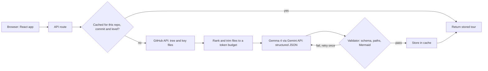

Contents

1. [Summary](#summary)
2. [Problem and users](#problem)
3. [Market research](#market)
4. [Competitors](#competitors)
5. [The gap](#gap)
6. [Product definition](#product)
7. [Feature scope](#features)
8. [Result screen](#experience)
9. [Technical design](#architecture)
10. [Evaluation plan](#evaluation)
11. [Winning plan](#win)
12. [Build plan](#plan)
13. [Risks](#risks)
14. [Open questions](#open)
15. [Sources](#sources)

Product requirements · Gemma hackathon · Problem 18

# RepoTrail

A guided first-day tour of any public GitHub repository, written for the person who has never seen it and does not know which file to open first.

- Working title, check the name before launch
- Draft 1 · 6 Oct 2026
- Research current as of that date

On this page

1. [Summary](#summary)
2. [Problem and users](#problem)
3. [Market research](#market)
4. [Competitors](#competitors)
5. [The gap](#gap)
6. [Product definition](#product)
7. [Feature scope](#features)
8. [Result screen](#experience)
9. [Technical design](#architecture)
10. [Evaluation plan](#evaluation)
11. [Winning plan](#win)
12. [Build plan](#plan)
13. [Risks](#risks)
14. [Open questions](#open)
15. [Sources](#sources)

## Summary

Explaining a GitHub repository is no longer an open niche. DeepWiki, Google's Code Wiki and GitDiagram all generate docs or diagrams for public repos, and at least two of them are free. A team that pitches "we explain repos" will be compared to them in the first minute.

RepoTrail takes a different job. Those tools document a repository for people who can already read code. RepoTrail teaches a beginner how to read it: an ordered reading path, explanations at the reader's level, a glossary drawn from the repo, and a check that the reader understood. Every file it names is verified against the repo before it is shown.

Users

Students and first-time contributors facing an unfamiliar repo. Bootcamp grads and new hires second.

Wedge

Teach the reading, not the architecture. Show proof that every reference is real.

Model

Gemma 4 through the Gemini API. No local GPU. Open weights keep a self-hosting story available.

MVP

Paste a URL. Get overview, reading path, glossary, run steps and a verified-references badge. Quiz and first-issue finder if time allows.

Be realistic

Nothing here guarantees a win. What the plan does is remove the common ways teams lose: a demo that breaks, claims that cannot be shown, and a pitch that sounds like something the judges have already seen.

## Problem and users

A beginner lands on a repository with hundreds of files. The README says what the project does, but not where the code starts, which folders matter, or what the vocabulary means. Most people close the tab. The ones who stay read files in alphabetical order.

Research on newcomers to open source groups the barriers into five categories: finding a way to start, social interactions, code issues, documentation problems, and the newcomer's own knowledge. RepoTrail goes after the first, third and fourth.

### Who it is for

| Persona (illustrative) | Situation | What they need |
| --- | --- | --- |
| Primary: second-year CS student | Wants a first open-source pull request. Opens a repo, sees 400 files, does not know the entry point. | A short path from README to the first meaningful file, in plain words. |
| Secondary: bootcamp graduate | Joins a startup with a three-year-old codebase on day one. | A map of the main components and the order to read them. |
| Tertiary: maintainer | Keeps answering "where do I start?" in issues. | A "start here" link to put in CONTRIBUTING.md. |

### Core user stories

- As a beginner, I paste a repo URL and see, within a minute, which five to eight files to read and in what order.
- As a beginner, I switch from Beginner to Intermediate and the explanations change depth.
- As a beginner, I can see that the file names in the tour exist, and click straight to them on GitHub.
- As a beginner, I answer a few questions to find out whether I understood the repo.
- As a first-time contributor, I see which "good first issue" tasks touch the files I just learned.

## Market research

No reliable market-size figure exists for "repo explainer tools", and inventing one would not survive a judge's question. The defensible way to size this is the number of people who are new to code and already live on GitHub.

- **180M+**developers on GitHub, per the Octoverse 2025 report
- **36M**new developers in the 12 months to 31 Aug 2025, about one every second
- **5.2M**of those from India, 14% of new accounts and the largest source
- **\~80%**of new developers used Copilot within their first week

Figures from Octoverse 2025, as reported by [Forbes](https://www.forbes.com/sites/janakirammsv/2025/11/01/10-key-takeaways-from-github-octoverse-2025-report/) and [It's FOSS](https://itsfoss.com/news/github-octoverse-2025/). GitHub projects India to reach 57.5 million developers by 2030.

### What the numbers imply

- **The audience is large and new.** A new developer joins every second, and most of them will meet an unfamiliar repo within weeks.
- **They expect AI help from day one.** If four in five new developers already use an AI assistant, an AI-guided tour is a normal thing to ask for.
- **India is the largest source of new developers.** Hackathon judges in India will recognise this audience, and Gemma 4's training across more than 140 languages makes local-language explanations a credible next step.

### The pain is documented

- A [systematic review of 21 studies](https://link.springer.com/chapter/10.1007/978-3-642-55128-4_21) found that newcomers to open source struggle most with their own prior skills, getting responses from the community, and finding a way to start.
- A [study of student contributors](https://doi.org/10.1145/3786580.3786971) found that knowing the language does not prepare students for a project's architecture, and that issues meant for newcomers often still needed a lot of context. That is the gap between "good first issue" and an issue a beginner can actually start.
- A UC Berkeley paper on [navigating unfamiliar codebases](https://arxiv.org/pdf/2405.06271) cites earlier work reporting that developers spend about 58% of their time on program comprehension. This is a secondhand figure, so quote it as "cited in".

Use with care

Vendor blogs quote onboarding times anywhere from two to four weeks up to six to nine months for new hires. The sources disagree and most sell a product. Use them only to say that onboarding to a codebase takes time, not to quote a number.

### How the market is priced

Tools for individuals are free or close to it. DeepWiki is free for public repos, GitDiagram is free and open source, and Code Wiki is a public preview with no price in the coverage reviewed. Paid products target teams: Greptile starts at about $30 per seat per month and Unblocked lists $29 per user per month. One review site reports that Sourcegraph stopped new free and Cody Pro signups in mid-2025, so no self-serve individual tier remains.

For a hackathon, monetisation is not scored. If asked, a credible path is institutional: universities, bootcamps and open-source projects paying to publish tours for their own repos. This is an inference, not a researched result.

## Competitors

Reviewed on 6 Oct 2026 from product docs, READMEs and third-party coverage. Products in this space change monthly, so recheck DeepWiki and Code Wiki the morning of the event.

| Tool | What it does | Access | Built for |
| --- | --- | --- | --- |
| [DeepWiki](https://docs.devin.ai/work-with-devin/deepwiki) (Cognition) | Auto-generates a wiki with architecture diagrams and source links, plus "Ask Devin" Q&A. Has codemaps, multi-language wikis, a steering file (`.devin/wiki.json`) and a [free MCP server](https://docs.devin.ai/work-with-devin/deepwiki-mcp) for agents. | Free for public repos. Private repos need a Devin account. | Engineers and AI agents |
| [Code Wiki](https://developers.googleblog.com/introducing-code-wiki-accelerating-your-code-understanding/) (Google) | Public preview since 13 Nov 2025 at codewiki.google. Regenerates docs after each change, draws architecture, class and sequence diagrams, and has a Gemini chat grounded in the wiki. | Public preview for public repos. No price appears in the coverage reviewed. A Gemini CLI extension for private repos was announced as coming. Check whether it has shipped. | Engineers |
| [GitDiagram](https://gitdiagram.com/) | Swap "hub" for "diagram" in a GitHub URL to get an interactive architecture diagram. Components link to source files. Exports PNG or Mermaid. Added one-minute narrated explainer videos and an MCP server. | Free and open source. Private repos with your own GitHub token. | Anyone who wants a quick structural picture |
| [Gitingest](https://github.com/coderamp-labs/gitingest) and Repomix | Turn a repo into one LLM-ready text file. They do not explain anything. | Free, open source. Gitingest also has a Chrome extension with about 8,000 users. | People feeding code to an LLM |
| Greptile, Sourcegraph Cody, Unblocked | Index a codebase for Q&A, search and pull-request review. [One roundup](https://ssojet.com/blog/ai-codebase-understanding-tools) notes Greptile leads with PR review, so standalone Q&A is mostly an API. | Paid, per seat or enterprise. | Engineering teams |
| Open-source DeepWiki clones | Several GitHub projects re-implement DeepWiki and advertise Gemini, OpenAI and Ollama backends, with a repo Q&A feature. | Free, self-hosted. | Hobbyists and hackathon teams |

### What this means for judging

- Other teams on Problem 18 can start from a DeepWiki clone in an hour. Expect at least some entries that look like a wiki generator with a chat box.
- A judge who has used DeepWiki will ask the difference. The answer must come in one sentence and be visible on screen.
- Diagrams alone are table stakes now. They are included in RepoTrail because users expect them, and they are not the pitch.

## The gap

In the documentation and READMEs reviewed, none of these tools offered the following. This is a statement about what was found, not proof that nobody has built it.

| Capability | DeepWiki | Code Wiki | GitDiagram | RepoTrail |
| --- | --- | --- | --- | --- |
| Free for public repos | Yes | Preview, no price stated | Yes | Yes |
| Architecture diagram | Yes | Yes | Yes | Yes |
| Q&A on the repo | Yes | Yes | Not found | Later (P2) |
| Ordered "read these first" path | Not found | Not found | Not found | Yes |
| Explanations at a chosen level | Not found | Not found | Not found | Yes |
| Glossary built from the repo | Not found | Not found | Not found | Yes |
| Comprehension quiz | Not found | Not found | Not found | Yes (P1) |
| Beginner issues mapped to files | Not found | Not found | Not found | Yes (P1) |
| File references verified and shown | Not found | Not found | Not found | Yes |
| Open-weights model | Not stated | No (Gemini) | No | Yes (Gemma 4) |

### Positioning statement

For students and first-time contributors who open an unfamiliar repo and do not know where to start, RepoTrail is a tour generator that gives an ordered reading path and checks understanding. DeepWiki, Code Wiki and GitDiagram document a repo for people who can already read code. RepoTrail teaches the reading.

The one-sentence answer to "how is this different from DeepWiki" is: *DeepWiki tells you what is in the repo. RepoTrail tells you what to read first and checks that you got it.*

## Product definition

### Goals for the hackathon

- **G1.** For any public repo under the size cap, produce a useful tour. Proposed targets: under 2 seconds when cached, under 60 seconds when generated live.
- **G2.** Never show a file reference that does not exist in the repo.
- **G3.** Survive a live demo: pre-cached examples, graceful errors, a recorded backup.
- **G4.** Produce measured evidence, not adjectives: a small benchmark and a side-by-side against an existing tool.

### Non-goals

- Private repositories, accounts and authentication.
- Editing code, generating patches or reviewing pull requests.
- Replacing a project's README or docs.
- Very large monorepos. These get a clear "too large, showing top-level folders only" state.

### Design principles

- **Say less, and prove it.** Five files with reasons beat a forty-page wiki.
- **Never invent.** If the repo has no run instructions, say so. Do not guess a command.
- **Teach the vocabulary.** Beginners stall on terms, not on logic.
- **Same output, two depths.** The level toggle changes wording, not structure.

## Feature scope

P0 is the minimum demo. P1 is added only after P0 works end to end. P2 appears on the roadmap slide and nowhere else.

| Feature | Priority | Acceptance criteria |
| --- | --- | --- |
| Repo input and examples | P0 | Accepts a GitHub URL or `owner/repo`. Invalid input shows a clear message. Five pre-cached example repos are one click away. |
| Overview | P0 | One short paragraph on what the project does, its stack and who uses it. |
| Reading path | P0 | Five to eight files in order. Each has a reason to read it and one thing to look for. Each links to the file on GitHub. |
| Architecture map | P0 | A Mermaid diagram with four to eight components. If the diagram fails to parse, fall back to an annotated folder tree. |
| Level toggle | P0 | Beginner and Intermediate. Results cached per level. Switching does not re-fetch the repo. |
| Glossary | P0 | Five to ten terms that appear in this repo's files, each explained with the file where it shows up. |
| Run it locally | P0 | Steps taken from the README and manifest files. If none exist, the screen says so. |
| Verified-references badge | P0 | Shows "N of N file references verified". Unverified paths are dropped before display. |
| Comprehension quiz | P1 | Five questions, each tied to a file. Answers reveal on click with the source file. |
| First-contribution finder | P1 | Pulls open issues labelled "good first issue" and maps each to files from the reading path. Shows a clear message if there are none. |
| Share link | P1 | A stable URL for a tour, keyed by repo and commit. |
| Ask a question | P2 | Chat grounded in the same context pack. |
| Local-language tours | P2 | Hindi and other languages. Gemma 4 is trained on more than 140 languages, but quality per language must be tested. |
| Export START_HERE.md | P2 | Maintainers download the tour as a file for their repo. |
| Self-host mode | P2 | Run the same pipeline against local Gemma weights so private code never leaves the machine. |

## Result screen

One page, top to bottom: summary, reading path, then the glossary and run steps beside it. The mock below is illustrative. The repository named in it does not exist.

acme/notes-api BeginnerIntermediate 7 of 7 file references verified

#### Overview

A small web service for saving short notes. It is written in TypeScript with Express and stores data in PostgreSQL. Start with the route files to see what the service offers.

#### Start here

1. 1

   README.md

   Explains what the service does and how to run it. Look for the Environment section.
2. 2

   src/server.ts

   Where the program starts. Look for the port and the middleware it loads.
3. 3

   src/routes/notes.ts

   Every note endpoint lives here. Look for the five HTTP methods.
4. 4

   src/db/schema.sql

   The shape of the stored data. Look for the notes table.
5. 5

   tests/notes.test.ts

   Examples of expected behaviour. Read after the routes.

#### Words you will see

Middleware

A function that runs before your route handler. In src/server.ts one of them logs every request.

Endpoint

A URL the service answers, such as the one that lists notes.

Schema

The plan for how data is stored. See src/db/schema.sql.

#### Run it locally

Install packages, copy .env.example to .env, then start the dev script. Source: README.md.

The demo should use a real repo from the benchmark set, not this mock.

## Technical design

One React page and one serverless API route. No database server, no GPU, no accounts. The model call happens on the server so the API key never reaches the browser.



### Pipeline

1. **Resolve.** Read the default branch and its latest commit SHA. The SHA becomes part of the cache key.
2. **List.** Fetch the full file tree in one call. Drop lockfiles, vendored folders, build output, binaries and generated code.
3. **Rank.** Score the rest by simple rules: README, package manifests (`package.json`, `pyproject.toml`, `go.mod`, `Cargo.toml`), entry points (`main`, `index`, `app`, `cmd/`), config, Dockerfile and CI files rank high. Shallow paths beat deep ones.
4. **Pack.** Build one context: a folder summary, the README, and the first lines of the top-ranked files, trimmed to a token budget.
5. **Generate.** Ask Gemma 4 for JSON matching the schema below. A second call produces glossary, run steps and quiz so each call stays small.
6. **Validate.** Check the schema, check that every `path` exists in the file tree, and parse the Mermaid text. On failure, retry once with the error message. After that, drop what is invalid and say so.
7. **Cache and serve.** Store by repo, commit and level.

### Output schema

```
{
  "overview":  { "summary": "string", "stack": ["string"], "audience": "string" },
  "components": [ { "id": "string", "name": "string", "role": "string", "paths": ["string"] } ],
  "edges":     [ { "from": "id", "to": "id", "label": "string" } ],
  "reading_path": [ { "order": 1, "path": "string", "why": "string", "look_for": "string" } ],
  "glossary":  [ { "term": "string", "plain": "string", "seen_in": "path" } ],
  "run_steps": [ { "step": "string", "source": "path", "confidence": "high | low" } ],
  "quiz":      [ { "q": "string", "a": "string", "path": "string" } ]
}
```

### Gemma 4 notes

- **Models.** `gemma-4-31b-it` for quality and `gemma-4-26b-a4b-it` as the lighter option, both on the Gemini API and AI Studio. Both support 256K context, structured output, a native system prompt and a thinking mode, and ship under Apache 2.0 ([model card](https://ai.google.dev/gemma/docs/core/model_card_4), [API guide](https://www.philschmid.de/gemma-4-gemini-api)).
- **Do not rely on the big context window.** Google's [rate-limit page](https://ai.google.dev/gemini-api/docs/rate-limits) does not print Gemma 4 quotas and points to the AI Studio dashboard. A third-party tracker reports Gemma 4 as free-tier only. Earlier Gemma 3 limits were 30 requests and 15,000 tokens per minute. If Gemma 4 is similar, a single 100K-token call would be impossible. Plan on roughly 10,000 to 20,000 tokens per call until the real numbers are known.
- **Why the pipeline is built this way.** Pre-generation, caching by commit, small calls and one retry all follow from that quota uncertainty.

### GitHub access

Unauthenticated GitHub API calls are limited to 60 per hour per IP, while a token allows 5,000. Use a server-side token. Fetch the tree once, and fetch only the selected files rather than cloning the repo.

### Suggested stack

Vite and React for the page, Mermaid for diagrams, one Vercel or Cloudflare function for the API, and the platform's key-value store for the cache. Seed the cache with the demo repos before the event so the demo does not depend on live quota.

## Evaluation plan

The problem sheet's build tip lists "evaluation examples" next to clean UI, real-world data, error handling and a clear demo. Most teams will skip it, so a small honest evaluation stands out.

### Benchmark set

| Slot | Why it is there |
| --- | --- |
| Small Python CLI | Easy case. Should be near perfect. |
| Mid-size JavaScript or TypeScript web app | The typical case a student meets. |
| Go or Rust service | Different layout and manifest files. |
| Repo with a weak README | Tests that the tool says "not found" instead of inventing. |
| Very large repo | Tests the size cap and the fallback message. |

### Measures

- **Reference accuracy before validation.** What share of file paths the model cited did not exist? Report this number, then show that the validator brings the displayed figure to zero. This is the strongest single slide.
- **Reading-path usefulness.** Show RepoTrail's tour and the same repo's DeepWiki page to three people who have not seen the repo. Ask each to name the entry point and where a new endpoint would go. Record time and correctness.
- **Quiz answerability.** Spot-check that each quiz answer can be found in the cited file.
- **Latency.** Cached and live, measured on the deployed site.

Targets in this document are proposals. Claim only what is measured, and say how many repos and people were involved.

## Winning plan

### Map to what the sheet asks for

| Criterion | How RepoTrail answers it | Proof on stage |
| --- | --- | --- |
| Clean UI | One page, one reading order, large type for paths, no dashboard clutter. | The result screen itself. |
| Real-world data | Works on live public GitHub repos, not toy text. | A repo chosen from the audience shortlist. |
| Evaluation examples | Five-repo benchmark and a side-by-side against an existing tool. | One evaluation slide with real numbers. |
| Error handling | Invalid URL, private repo, huge repo, no README and rate limit each have a designed state. | Paste a private repo URL on purpose and show the message. |
| Clear demo | One story from "where do I start?" to "I know what to read". | The three-minute script below. |

### Three-minute demo

| Time | On screen | Say |
| --- | --- | --- |
| 0:00 | A real repo's GitHub page with a long file list. | "Where do you start? Most beginners open files alphabetically." |
| 0:20 | Paste the URL into RepoTrail. Progress shows scanning. | "It reads the file tree, picks the files that matter and asks Gemma 4." |
| 0:50 | Reading path. Click step 1 and the file opens on GitHub. | "Every file name here is checked against the repo first. Seven of seven verified." |
| 1:30 | Toggle Beginner to Intermediate. Open the glossary. | "Same tour, different depth. The terms come from this repo's own files." |
| 2:00 | Quiz question, then the first-issue mapping. | "It checks that you understood, then points you at a real beginner issue." |
| 2:30 | Evaluation slide, then the roadmap slide. | "Without validation the model cited paths that do not exist. With it, none are shown. Open weights mean this can run on your own machine." |

### Fail-safes

- Pre-cache ten repos, including the five benchmark repos and five a judge is likely to name.
- Record a full run as a video and keep it one click away.
- Do the live generation of a fresh small repo only after the cached demo, so a failure costs nothing.
- Test on the venue's network before the slot, and keep a phone hotspot ready.

### Questions to expect

| Question | Answer |
| --- | --- |
| How is this different from DeepWiki or Code Wiki? | They document a repo for engineers. RepoTrail gives a beginner an ordered path, adjusts the depth, and checks understanding. Show the side-by-side. |
| What stops it from making things up? | Every cited path is checked against the real file tree and unverified ones are removed. Run steps are marked low confidence when the repo has no instructions. Show the measured before and after. |
| Why Gemma? | Open weights under Apache 2.0, long context, structured output and a hosted API for the demo. The same pipeline can run locally for private code. |
| What about private repos? | Out of scope for the MVP by design. The self-host path is how it would be done. |
| Who pays for it? | Individuals use it free. Universities, bootcamps and open-source projects are the likely buyers. This is an assumption to be tested. |

## Build plan

The event length is not known yet, so the plan is by share of time. Scale it to the hours available.

| Phase | Share | Output |
| --- | --- | --- |
| 0. Setup and checks | 5% | Rules confirmed, Gemma 4 quota read from AI Studio, repo created, empty page deployed. |
| 1. Repo data | 20% | URL in, ranked file list and context pack out. |
| 2. Model and validator | 25% | Schema-valid JSON, path check, Mermaid check, retry. |
| 3. Interface | 25% | Result screen, level toggle, error states. |
| 4. Cache, evaluation, polish | 15% | Ten repos cached, benchmark numbers, share link. |
| 5. Rehearsal | 10% | Three full run-throughs, backup video, slides. |

Cut line

If the build is behind at 60% of the time, drop the quiz, the issue finder and the share link. Never drop the validator, the reading path, the level toggle or the rehearsal.

### Work packages for coding agents

Give each package to an agent with its definition of done. Packages 1, 2 and 3 can run in parallel.

| Package | Scope | Done when |
| --- | --- | --- |
| 1. Repo reader | GitHub fetch, file filtering, ranking and token-budgeted context pack. | Five benchmark repos produce a pack under budget with a README and manifests included. |
| 2. Generator and validator | Prompts, schema, Gemma call, retry, path and Mermaid validation. | Schema-valid output on all five repos and zero unverified paths displayed. |
| 3. Interface | React result screen, level toggle, loading, all error states. | Works at phone width and desktop, in light and dark. |
| 4. Cache and deploy | Key-value cache by repo, commit and level. Seed script for demo repos. Deployment. | Cached result in under 2 seconds on the live site. |
| 5. Evaluation harness | Script that runs the benchmark and reports reference accuracy before and after validation. | One command produces the numbers for the evaluation slide. |

## Risks

| Risk | Effect | Response |
| --- | --- | --- |
| Gemma 4 free-tier quota is low | Live generation is slow or fails mid-demo. | Read the real limits on day one. Pre-cache. Keep calls small. Queue with backoff and show progress. |
| Hackathon rules on model hosting | A hosted Gemma API might not be allowed, or might be required. | Ask the organisers before building. Design the model call behind one function so the endpoint can change. |
| Model cites files that do not exist | Loss of trust in the demo. | Validator drops them. Measure the before and after. |
| Mermaid output does not parse | Blank diagram. | Parse before display. Fall back to the annotated folder tree. |
| GitHub API limits | Fetch failures. | Server-side token. One tree call. Fetch only selected files. |
| Another team builds the same thing | Judges see two similar projects. | Lead with reading path, level toggle and verification. Do not lead with diagrams or chat. |
| Competitors add these features | The gap narrows before the event. | Recheck DeepWiki and Code Wiki the morning of the event and adjust the pitch. |
| Venue network fails | No live demo. | Cached results, recorded video, hotspot. |

## Open questions

- Does the hackathon require Gemma to run locally, allow a hosted API, or require a specific platform?
- How long is the event, and how many people are on the team?
- What are the judging weights? The problem sheet gives a build tip but no scoring rubric.
- What are the real Gemma 4 rate limits for this account in AI Studio?
- Is the name RepoTrail free to use? Check before putting it on a slide.
- Has Code Wiki's private-repo extension shipped, and has DeepWiki added any learning features?

## Sources

1. Hackathon problem sheet, "30 AI / Gemma Hackathon Problem Statements", problem 18 and the build tip.
2. [DeepWiki docs](https://docs.devin.ai/work-with-devin/deepwiki) and [DeepWiki MCP docs](https://docs.devin.ai/work-with-devin/deepwiki-mcp), Devin Docs.
3. [Devin release notes 2025](https://docs.devin.ai/release-notes/2025), for codemaps and multi-language wikis.
4. [Introducing Code Wiki](https://developers.googleblog.com/introducing-code-wiki-accelerating-your-code-understanding/), Google Developers Blog. Also [It's FOSS](https://itsfoss.com/news/google-code-wiki/) and [DevOps.com](https://devops.com/google-code-wiki-aims-to-solve-documentations-oldest-problem/) coverage.
5. [GitDiagram](https://gitdiagram.com/) and its [GitHub repository](https://github.com/ahmedkhaleel2004/gitdiagram).
6. [Gitingest repository](https://github.com/coderamp-labs/gitingest) and its [Chrome Web Store listing](https://chromewebstore.google.com/detail/gitingest-turn-any-git-re/adfjahbijlkjfoicpjkhjicpjpjfaood).
7. [7 AI Tools for Codebase Onboarding and Understanding](https://ssojet.com/blog/ai-codebase-understanding-tools), for Greptile, Unblocked and Sourcegraph pricing and availability, verified by that site on 22 Jun 2026.
8. [Best AI code review tools 2026](https://www.getoptimal.ai/blog/best-ai-code-review-tools), for Greptile pricing.
9. Octoverse 2025 via [Forbes](https://www.forbes.com/sites/janakirammsv/2025/11/01/10-key-takeaways-from-github-octoverse-2025-report/) and [It's FOSS](https://itsfoss.com/news/github-octoverse-2025/).
10. [Barriers Faced by Newcomers to Open Source Projects: A Systematic Review](https://link.springer.com/chapter/10.1007/978-3-642-55128-4_21), Steinmacher, Silva and Gerosa.
11. [What barriers do students experience when trying to contribute to Open Source Software projects?](https://doi.org/10.1145/3786580.3786971)
12. [Code Compass: A Study on the Challenges of Navigating Unfamiliar Codebases](https://arxiv.org/pdf/2405.06271), UC Berkeley.
13. [Developer Onboarding in 2026](https://sourcegraph.com/blog/developer-onboarding), Sourcegraph blog. A vendor source.
14. [Gemma 4 model card](https://ai.google.dev/gemma/docs/core/model_card_4), [How to use Gemma 4 with the Gemini API](https://www.philschmid.de/gemma-4-gemini-api) and the [Gemini API changelog](https://ai.google.dev/gemini-api/docs/changelog).
15. [Gemini API rate limits](https://ai.google.dev/gemini-api/docs/rate-limits) and a [third-party free-tier tracker](https://www.memetik.ai/guides/gemini-api-free-tier-limits) dated 28 Sep 2026.

Competitor and quota details were gathered on 6 Oct 2026 and can change. Personas, targets and the demo script are proposals, not research results.