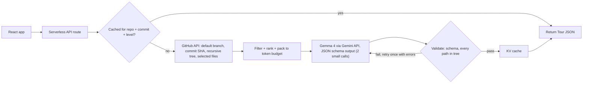

# DestructGitHub — project summary (handoff for the next agent)

Snapshot: 6 Oct 2026. Source of truth for intent: `RepoTrail PRD.md` (product) and `design.md` (visual direction). This file describes what is actually built and what remains.

## 1. What the product is

DestructGitHub turns any public GitHub repository into a guided learning path for someone who has never seen it. Paste a URL and get four stages:

1. **Understand**: overview, stack, an ordered "start here" reading path, the components and how they connect, and a glossary drawn from the repo.
2. **Check your level**: five placement questions that place the user as novice, intermediate or advanced.
3. **Three projects**: warm-up, core work and blind rebuild. Each uses real files from the repo, and the user's level decides where to start.
4. **Rebuild guide**: a phased, end-to-end rebuild from an empty folder. Each step has a command, a "done when" check and the source file.

Every file path shown must be verified against the real repo tree. This "never invent" rule is the core trust promise.

Built for the Gemma hackathon (Problem 18). The model is Gemma 4 via the Gemini API (`gemma-4-31b-it`, with `gemma-4-26b-a4b-it` as the lighter option).

**Name:** the product is **DestructGitHub**. The PRD uses the earlier working title "RepoTrail". Treat the PRD as requirements, not branding.

## 2. Current status

- **Hour-1 UI prototype only.** Every screen renders one hard-coded mock tour (`src/data/mockTour.ts`) for a made-up repo, `harbor/notes-api`.
- No backend, no API route, no GitHub fetch, no model call, no validator, no cache.
- The site header says so: "hour-1 build · tour data mocked · live pipeline lands in hour 2".
- `npm run build` (tsc + vite) has been run, and `dist/` exists.
- Git: there is one commit (`886da94 planning`), and it only adds agent skills. **All app code is uncommitted** (`src/`, `index.html`, `package.json`, `package-lock.json`, `tsconfig.json`, `vite.config.ts`). There is no `.gitignore`, so `node_modules/` and `dist/` show as untracked.

## 3. Architecture as built

### Stack

- Vite 5, React 18, TypeScript 5 (strict, `noUnusedLocals`/`noUnusedParameters`, `moduleResolution: bundler`, `noEmit`).
- No runtime dependencies beyond `react` and `react-dom`. No router, no state library, no CSS framework.
- Scripts: `npm run dev`, `npm run build` (`tsc --noEmit && vite build`), `npm run preview`.
- `package.json` name: `destructgithub`.

### File map

```
index.html                 Title, meta description, Google Fonts, inline SVG favicon
vite.config.ts             React plugin only
src/main.tsx               createRoot → <App/>, imports styles.css
src/App.tsx                Top-level view/stage state machine
src/types.ts               Tour data model (the contract the backend must produce)
src/styles.css             All styling (~585 lines), design tokens at the top
src/lib/github.ts          blobUrl(repo, branch, path), repoUrl(repo). URL builders only
src/data/mockTour.ts       MOCK_TOUR (the only data source) and EXAMPLE_REPOS
src/components/
  Home.tsx                 Hero, URL input + validation, example chips, unfurling file tree
  Generating.tsx           Scripted progress lines on timers, then onDone
  Trail.tsx                Left rail (4 stage nodes + repo/commit/verified meta), mobile crumb
  Understand.tsx           Stage 1
  Placement.tsx            Stage 2
  Projects.tsx             Stage 3
  Rebuild.tsx              Stage 4 (+ CopyButton)
  Verified.tsx             "✓ N of N paths verified" badge
```

### State and flow (`src/App.tsx`)

- `view: "home" | "generating" | "tour"`
- `stage: Stage` = `"understand" | "placement" | "projects" | "rebuild"`
- `level: Level | null` = `"novice" | "intermediate" | "advanced"`. Set by Placement and read by Projects.
- `repo: string`. Set from Home, but **currently only shown on the Generating screen**. The tour is always `MOCK_TOUR`.
- `start(repo)` → generating. `Generating.onDone` → tour. `restart()` resets to home.
- Trail rail nodes let the user jump to any stage freely, with no gating.

### Data model (`src/types.ts`): the backend contract

```ts
Tour {
  repo, branch, commit, fetchedAt: string
  verified: { ok: number; total: number }
  overview: { summary; stack: string[]; audience }
  components: { id; name; role; paths: string[] }[]
  edges: { from: id; to: id; label }[]
  readingPath: { order; path; why }[]          // PRD's look_for is folded into `why`
  glossary: { term; plain; seenIn: path }[]
  placement: { question; options: string[]; answerIndex; tests }[]
  projects: { n; tag; title; goal; study: path[]; steps: string[]; checklist: string[]; minutes }[]
  rebuild: { phase; steps: { action; command?; check; source: path }[] }[]
  tree: { path; depth; kind: "dir" | "file" }[]   // for the home-page tree illustration
}
```

Path-bearing fields the validator must check: `components[].paths`, `readingPath[].path`, `glossary[].seenIn`, `projects[].study`, `rebuild[].steps[].source`.

### Components in detail

- **Home**: normalises input by stripping `https://github.com/`, `.git` and trailing slashes, then checks it against `^[\w.-]+\/[\w.-]+$`. Shows an inline error on failure. The chips are `EXAMPLE_REPOS` (`harbor/notes-api`, `openclaw/openclaw`, `expressjs/express`, `tiangolo/typer`). The right panel builds a nested tree from `MOCK_TOUR.tree` with a staggered `unfurl` animation, and hard-codes `src/server.ts` as "start here".
- **Generating**: six hard-coded status lines, revealed every 480 ms, then `onDone` after about 3.6 s. Has a Skip button and `role="status" aria-live="polite"`. Nothing in it is real.
- **Trail**: a sticky rail on screens 900px and wider, showing done/current/next states. On narrower screens a "step N of 4" crumb replaces it.
- **Understand**: the reading path links each file via `blobUrl`. The components grid lists linked paths. "Wiring" renders edges as `A ── label ──▶ B` text (no Mermaid). The glossary links `seenIn`. The CTA reads "Check my level".
- **Placement**: one button group per question (`aria-pressed`), "See my level", a result panel with a per-level line, "Tune my projects" (which calls `onLevel`), and "Retake the five".
- **Projects**: maps level to a start project (novice→1, intermediate→2, advanced→3) and shows per-project notes. Checklist ticks live in local `Set` state and are not persisted.
- **Rebuild**: phases → numbered steps (`1.1`, `1.2`…), a command block with Copy (clipboard API), "done when" and a source link. The closing panel restarts the flow.

## 4. Design system (follows `design.md`)

- Palette (`:root` in `styles.css`): `--paper #edf2ec` (background), `--chalk #fbfcfa`, `--ink #22362a`, `--ink-soft #5d6f60`, `--moss #2f6b43` (primary), `--moss-deep #1e4630`, `--bud #d9e6d5`, `--flag #b0512d` (accent), `--line #c7d6c6`.
- Type: **Bricolage Grotesque** (display/headings), **Alegreya Sans** (body, 17px / 1.55), **IBM Plex Mono** (paths, commands, meta).
- Layout: max width 1160px. The hero is a two-column grid at 980px and wider. The tour is a rail plus content grid at 900px and wider, and project columns split at 860px.
- Signature moment: the file tree unfurling on the home page, with "start here" flagged. This matches the design.md advice to spend boldness in one place.
- Motion: `leafIn`, `rise` and `pulse` keyframes, with `prefers-reduced-motion` respected. `:focus-visible` gives a moss outline.
- Deliberately avoids the design.md "AI default" palettes (cream/terracotta, near-black/neon).
- Copy voice: sentence case, plain verbs, errors that say how to fix the input.

## 5. Planned backend (not started, from the PRD)



1. **Resolve**: default branch and latest commit SHA (part of the cache key).
2. **List**: one recursive tree call. Drop lockfiles, vendored folders, build output, binaries and generated code.
3. **Rank**: README, manifests (`package.json`, `pyproject.toml`, `go.mod`, `Cargo.toml`), entry points (`main`, `index`, `app`, `cmd/`), config, Dockerfile and CI files score high. Shallow paths beat deep ones.
4. **Pack**: a folder summary, the README and the first lines of the top files, within about 10–20K tokens per call. Gemma 4 free-tier quotas are unknown, so don't rely on the 256K context.
5. **Generate**: call 1 covers overview, components, edges and reading path. Call 2 covers glossary, placement, projects and rebuild.
6. **Validate**: check the schema and that every path exists in the tree. Retry once, then drop invalid items and compute `verified.ok/total` from real checks. Also record pre-validation accuracy for the evaluation slide.
7. **Cache**: by repo + commit. Seed the demo repos ahead of time.

Constraints: server-side `GITHUB_TOKEN` (60 requests/hr unauthenticated vs 5,000/hr with a token) and a server-side Gemini key that never reaches the browser. Keep the model call behind one function so the endpoint can be swapped (local Gemma later). Suggested deploy: Vercel or Cloudflare function plus that platform's KV.

Required error states (PRD): invalid URL (done), private or not-found repo, repo too large (top-level folders only), no README, rate-limited, model failure.

## 6. How the build differs from the PRD

| PRD (RepoTrail) | Built (DestructGitHub) |
|---|---|
| Single result page | 4-stage trail with a side rail |
| Beginner/Intermediate toggle, cached per level | 3-level placement quiz that tunes the projects. No re-generation per level yet |
| Comprehension quiz (P1) | Replaced by the placement quiz |
| "Run it locally" steps | Expanded into a full rebuild guide |
| — | Three graded projects (new scope) |
| Mermaid diagram with a folder-tree fallback | Text wiring list. Mermaid not installed |
| `reading_path[].look_for` | Merged into `why` |
| snake_case schema (`seen_in`, `reading_path`) | camelCase (`seenIn`, `readingPath`) |
| First-issue finder, share link (P1) | Not started |
| Backend pipeline, validator, cache, eval harness | Not started |

## 7. Known issues

1. **Placement scoring bug** (`src/components/Placement.tsx:25`). The score adds up the selected option **indices** (`sum + a`) instead of counting `a === q.answerIndex`, so the level reflects button position, not correctness. Thresholds (≤4 novice, ≤11 intermediate, otherwise advanced) assume an index sum. Fix it to count correct answers, then use 0–1 → novice, 2–3 → intermediate, 4–5 → advanced (or similar).
2. The `repo` the user enters is ignored. Every repo shows `MOCK_TOUR` (`src/App.tsx:32`).
3. The Generating lines (file counts, "12 of 12 real") are hard-coded strings.
4. The verified badge shows `MOCK_TOUR.verified`. Nothing is actually checked.
5. The closing text in Rebuild hard-codes "214 files" and "four files".
6. Understand hard-codes the section note "four parts, three connections".
7. Home hard-codes `FIRST_PATH = "src/server.ts"`. It should come from `readingPath` (first non-README entry).
8. `harbor/notes-api` is fictional, and its `blobUrl` links lead to 404s on GitHub. `openclaw/openclaw` in `EXAMPLE_REPOS` should be checked to confirm it exists.
9. No loading, error or empty states for fetch or model failures (there is no fetch yet).
10. No `.gitignore`. The app code is uncommitted.
11. No tests, no linter config (`Generating.tsx` has an eslint-disable comment, but ESLint isn't installed).
12. No dark mode (the PRD's interface package asks for light and dark).

## 8. Suggested next steps (in order)

1. Add a `.gitignore` (`node_modules`, `dist`, `.env*`) and commit the prototype.
2. Fix the placement scoring bug.
3. **API route** (`/api/tour?repo=owner/name`) behind one `generateTour(repo)` function. Pick the platform (Vercel `api/` or a Cloudflare Worker) and configure `GITHUB_TOKEN` and `GEMINI_API_KEY`.
4. **Repo reader** (PRD WP1): resolve, tree, filter, rank, fetch selected files, pack under budget.
5. **Generator and validator** (PRD WP2): JSON schemas matching `types.ts`, two Gemma calls, path validation over every path-bearing field, one retry, then drop and count.
6. **Wire the frontend**: replace `MOCK_TOUR` with fetched data. Drive Generating from real progress (or honest indeterminate steps). Derive the counts and the "start here" path from data. Add error states.
7. **Cache and seed** (WP4): KV keyed by `repo@commit`, plus a seed script for about 10 demo repos. Keep `MOCK_TOUR` as an offline fallback.
8. **Evaluation harness** (WP5): one command over the 5-repo benchmark (Python CLI, mid-size JS/TS, Go/Rust, weak README, very large repo) that reports path accuracy before and after validation, plus latency.
9. Then P1/P2 work: Mermaid diagram with a tree fallback, first-issue finder, share link, dark mode.

Cut line (PRD): never drop the validator, the reading path, level adaptation or the rehearsal.
